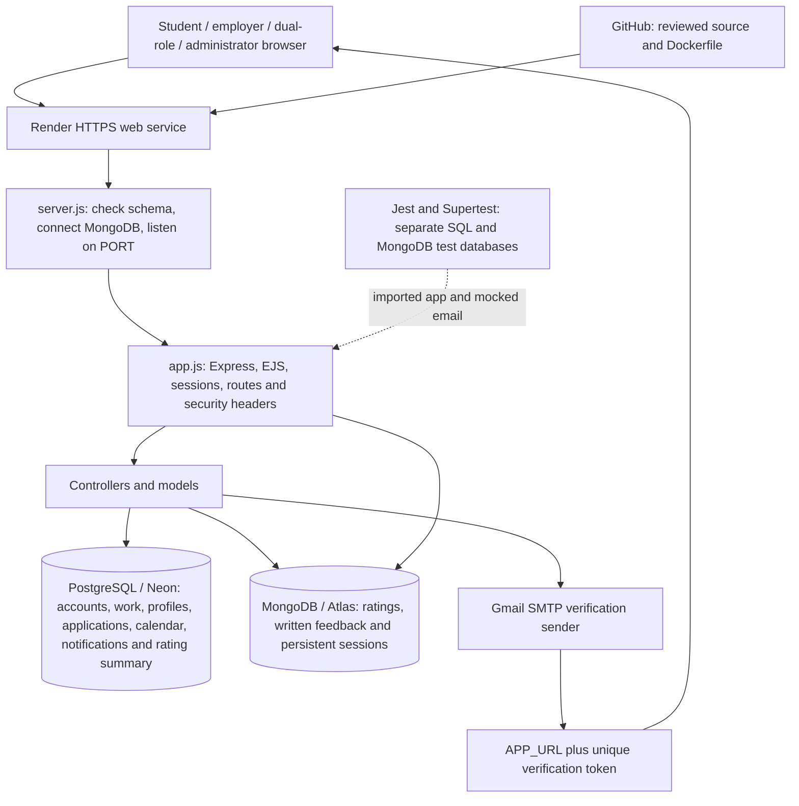

# Editable deployment architecture

This describes the planned deployment; it is not evidence of a live service. Edit [the Mermaid source](deployment-architecture.mmd) in any text editor.

PostgreSQL and MongoDB retain their separate roles. Tests use distinct databases and mocked email. Website and verification links share APP_URL while account tokens remain unique.
